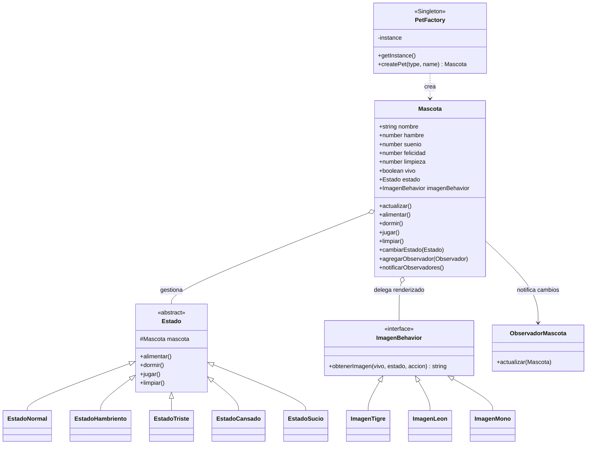

# 🦁 Wild Store - Tamagotchi 2.0 🐯🐵

[](https://developer.mozilla.org/es/docs/Web/JavaScript)
[](https://developer.mozilla.org/es/docs/Web/HTML)
[](https://developer.mozilla.org/es/docs/Web/CSS)
[](LICENSE)

**Tamagotchi 2.0** es un simulador interactivo de mascota virtual ambientado en la selva, desarrollado en JavaScript nativo (Vanilla JS), HTML5 y CSS3. Permite al usuario adoptar un animal salvaje (Tigre, León o Mono), asignarle un nombre y cuidar de sus necesidades biológicas y emocionales en tiempo real.

El proyecto destaca por una arquitectura modular orientada a objetos que implementa formalmente reconocidos **patrones de diseño de software** (*State*, *Strategy*, *Observer* y *Factory / Singleton*).

---

## 📋 Tabla de Contenidos

1. [Descripción del Proyecto](#-descripción-del-proyecto)
2. [Características Principales](#-características-principales)
3. [Mecánicas y Reglas del Juego](#-mecánicas-y-reglas-del-juego)
4. [Arquitectura y Patrones de Diseño](#-arquitectura-y-patrones-de-diseño)
5. [Estructura del Repositorio](#-estructura-del-repositorio)
6. [Requisitos del Sistema](#-requisitos-del-sistema)
7. [Instalación y Puesta en Marcha](#-instalación-y-puesta-en-marcha)
8. [Cómo Jugar](#-cómo-jugar)
9. [Posibles Mejoras Futuras](#-posibles-mejoras-futuras)
10. [Licencia y Créditos](#-licencia-y-créditos)

---

## 📖 Descripción del Proyecto

En **Wild Store**, el jugador ingresa a una tienda de adopción exótica donde debe:
1. Registrar y bautizar a su nueva mascota salvaje.
2. Elegir entre tres especies distintas: **Tigre**, **León** o **Mono**.
3. Trasladarse al hábitat de la mascota (`mundo.html`), donde un ciclo en tiempo real simula el paso de los segundos y desgasta los atributos vitales del animal.
4. Interactuar mediante acciones de cuidado: alimentarlo, hacerlo dormir, jugar con él y bañarlo para mantenerlo con vida y con buen ánimo.
5. Evitar que todas sus estadísticas lleguen al punto crítico de fallecimiento, el cual desencadena la pantalla de fin de juego (`muerte.html`) con opción a reiniciar.

---

## ✨ Características Principales

- **Adopción Personalizada**: Validación de nombre y selección de especie persistida en el navegador mediante `localStorage`.
- **Evolución Visual Dinámica**: Los sprites del animal cambian de acuerdo a su estado interno (normal, hambriento, comiendo, cansado, durmiendo, triste, jugando, sucio y bañado).
- **Simulación en Tiempo Real**: Un motor periódico (`setInterval`) ajusta las estadísticas cada segundo.
- **Ambientación Musical Integrada**: Pista musical de fondo con controles interactivos de reproducción (Play, Pausa) y deslizador de ajuste de volumen dinámico.
- **Sin Dependencias Externas**: Código 100% nativo (Vanilla JS, CSS3 puro, HTML5 semántico).

---

## 🎮 Mecánicas y Reglas del Juego

### 📊 Atributos Vitales

La mascota cuenta con cuatro barras de progreso (rango de 0 a 100):

| Atributo | Cambio por Segundo | Nivel Crítico | Efecto Crítico |
| :--- | :---: | :---: | :--- |
| **Hambre** | `+5` (aumenta) | $\ge 80$ | Pasa a **Estado Hambriento** |
| **Sueño** | `+3` (aumenta) | $\ge 80$ | Pasa a **Estado Cansado** |
| **Felicidad** | `-2` (disminuye) | $\le 20$ | Pasa a **Estado Triste** |
| **Limpieza** | `-2` (disminuye) | $\le 20$ | Pasa a **Estado Sucio** |

### 🛠️ Acciones de Cuidado Disponibles

- **🍖 Alimentar**: En estado normal reduce el hambre en `5` puntos; en estado hambriento sacia a la mascota por completo (`-100`).
- **💤 Dormir**: En estado normal reduce el sueño en `5` puntos; en estado cansado le permite descansar por completo (`-100`).
- **🎾 Jugar**: En estado normal sube la felicidad en `+5`; en estado triste eleva la felicidad al máximo (`+100`).
- **🛁 Limpiar**: En estado normal sube la higiene en `+5`; en estado sucio baña a la mascota completamente (`+100`).

### 💀 Condición de Muerte (Game Over)

Si el descuido es total y se cumplen simultáneamente las cuatro condiciones extremas:
$$\text{Hambre} \ge 100 \quad\land\quad \text{Sueño} \ge 100 \quad\land\quad \text{Felicidad} \le 0 \quad\land\quad \text{Limpieza} \le 0$$

La mascota fallece. El juego detiene el ciclo vital, muestra un mensaje de despedida y redirige automáticamente tras 3 segundos al cementerio (`muerte.html`), donde se puede pulsar **"Volver a Jugar"** para reiniciar la experiencia.

---

## 🏗️ Arquitectura y Patrones de Diseño

El código en `app.js` sigue principios de Programación Orientada a Objetos (POO) y desacopla responsabilidades aplicando los siguientes patrones de diseño:



### 1. Patrón State (Estado)
Modela los diferentes estados de ánimo y biológicos de la mascota (`EstadoNormal`, `EstadoHambriento`, `EstadoTriste`, `EstadoCansado`, `EstadoSucio`). Cada estado define cómo reaccionan las acciones a los estímulos.

### 2. Patrón Strategy (Estrategia)
La familia de clases `ImagenBehavior` (`ImagenTigre`, `ImagenLeon`, `ImagenMono`) encapsula el algoritmo para seleccionar la ruta de la imagen correspondiente según la especie, el estado actual y la acción en curso, desacoplando la representación gráfica de la lógica interna de `Mascota`.

### 3. Patrón Observer (Observador)
La clase `Mascota` actúa como sujeto observable. Cada vez que sus atributos cambian en el ciclo de actualización o por una interacción, invoca a `notificarObservadores()`. La clase `ObservadorMascota` se encarga de reflejar automáticamente esos cambios en los elementos del DOM (barras de progreso, textos de estado e imágenes).

### 4. Patrón Factory + Singleton
`PetFactory` se instancia como un Singleton mediante un closure/IIFE, exponiendo `getInstance()`. Su método `createPet(type, name)` centraliza la creación de la mascota, vinculándole la estrategia de imagen adecuada y el estado inicial.

---

## 📁 Estructura del Repositorio

```text
Tamagotchi2.0/
├── .gitignore               # Configuración de exclusiones para Git
├── README.md                # Documentación oficial del proyecto
├── app.js                   # Lógica central del juego, clases y patrones
├── index.html               # Pantalla de inicio y adopción
├── mundo.html               # Pantalla principal del hábitat interactivo
├── muerte.html              # Pantalla de fallecimiento (Game Over)
├── musicaFondo.mp3          # Pista de audio de fondo
│
├── Estilos/                 # Hojas de estilos en cascada (CSS)
│   ├── index.css            # Estilos de la tienda de adopción
│   ├── mundo.css            # Estilos del hábitat y paneles de stats
│   └── muerte.css           # Estilos de la escena de muerte/cementerio
│
├── Iconos/                  # Recursos gráficos de la interfaz
│   ├── pausa.png            # Icono de pausa musical
│   ├── play1.png            # Icono de reproducir música
│   └── volumen.png          # Icono de nivel de volumen
│
└── ImagenesT/               # Fondos y sprites de estados de las mascotas
    ├── Fondo.png            # Fondo de la pantalla principal
    ├── fondoMundo.png       # Fondo del hábitat natural
    ├── cementerio.png       # Fondo de la pantalla de muerte
    ├── tumba.png            # Ilustración de tumba
    ├── leon*.png            # Sprites del León (feliz, cansado, comiendo...)
    ├── tigre*.png           # Sprites del Tigre (feliz, cansado, comiendo...)
    └── mono*.png            # Sprites del Mono (feliz, cansado, comiendo...)
```

---

## 💻 Requisitos del Sistema

- **Sistema Operativo**: Windows, macOS o Linux.
- **Navegador Web**: Cualquier navegador moderno con soporte para HTML5, CSS3, ES6 JavaScript y LocalStorage (Google Chrome, Mozilla Firefox, Microsoft Edge, Safari, Brave, Opera).
- **Git**: Opcional, pero recomendado para control de versiones y clonación del repositorio.
- **No requiere**: Node.js, npm, compiladores ni servidores backend.

---

## 🚀 Instalación y Puesta en Marcha

### Opción 1: Apertura Directa en el Navegador (Más rápida)
1. Clona el repositorio o descarga los archivos:
   ```bash
   git clone <URL_DEL_REPOSITORIO>
   cd Tamagotchi2.0
   ```
2. Haz doble clic sobre el archivo `index.html` o ábrelo directamente en tu navegador preferido.

### Opción 2: Usando la extensión Live Server (Recomendado en VS Code)
1. Abre la carpeta del proyecto en **Visual Studio Code**.
2. Instala la extensión **Live Server** (si aún no la tienes).
3. Haz clic derecho sobre `index.html` y selecciona **"Open with Live Server"**.

### Opción 3: Servidor Local Ligero (Python / Node)
Si prefieres servirlo mediante un servidor HTTP local:

- **Con Python 3**:
  ```bash
  python -m http.server 8000
  ```
  Luego abre en tu navegador: `http://localhost:8000`

- **Con Node (npx serve)**:
  ```bash
  npx serve .
  ```

---

## 🕹️ Cómo Jugar

```
 ┌─────────────────┐       ┌─────────────────┐       ┌─────────────────┐
 │   index.html    │  ──>  │   mundo.html    │  ──>  │   muerte.html   │
 │ Adopta y nombra │       │ Cuida y vigila  │       │  Game Over      │
 └─────────────────┘       └─────────────────┘       └─────────────────┘
                                     │                        │
                                     └────── «Reiniciar» ─────┘
```

1. **Paso 1**: Ingresa el nombre que deseas darle a tu mascota en el campo de texto y presiona **"Establecer nombre"**.
2. **Paso 2**: Selecciona a tu compañero entre los botones habilitados: **Tigre**, **León** o **Mono**.
3. **Paso 3**: En la pantalla de cuidados, observa las barras de estado. Si alguna se deteriora, pulsa el botón correspondiente (**Alimentar**, **Dormir**, **Jugar**, **Limpiar**).
4. **Paso 4**: Controla la música usando los botones superiores de Play, Pausa y el regulador de volumen.
5. **Paso 5**: ¡Mantenlo saludable todo el tiempo que puedas!

---

## 💡 Posibles Mejoras Futuras

- [ ] Guardar el progreso y estado de los atributos en `localStorage` para reanudar partidas.
- [ ] Incorporar sistema de envejecimiento / etapas de crecimiento (bebé, adulto, anciano).
- [ ] Agregar mini-juegos interactivos para subir la felicidad.
- [ ] Implementar un selector de fondos o climas variables.
- [ ] Efectos de sonido específicos para cada acción (masticar, roncar, risa, chapoteo).

---

## 📄 Licencia y Créditos

Este proyecto fue desarrollado con fines educativos para la práctica de **Patrones de Diseño de Software** y **Programación Orientada a Objetos**.

Distribuido bajo la licencia [MIT](LICENSE). Siéntete libre de utilizarlo, modificarlo y compartirlo.
